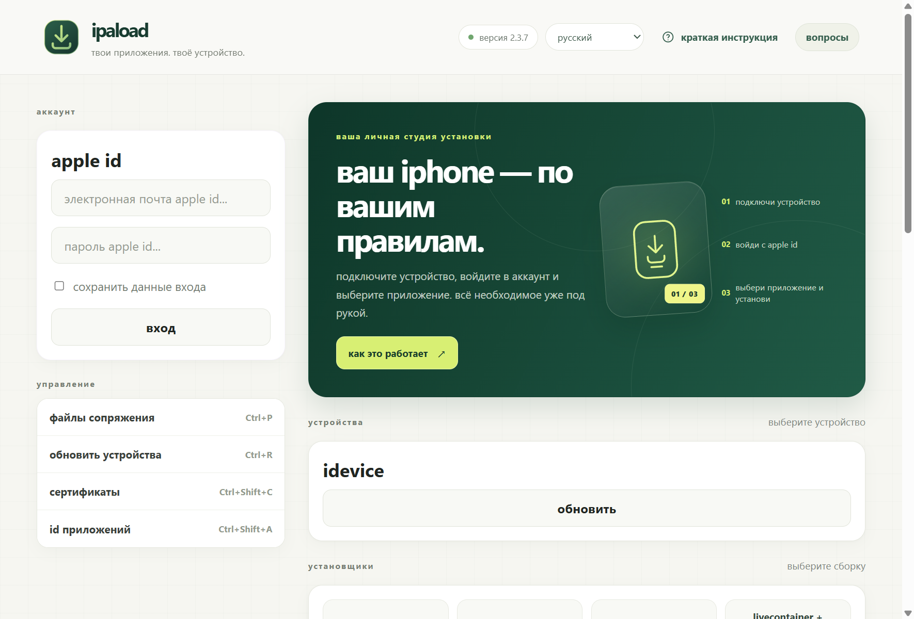
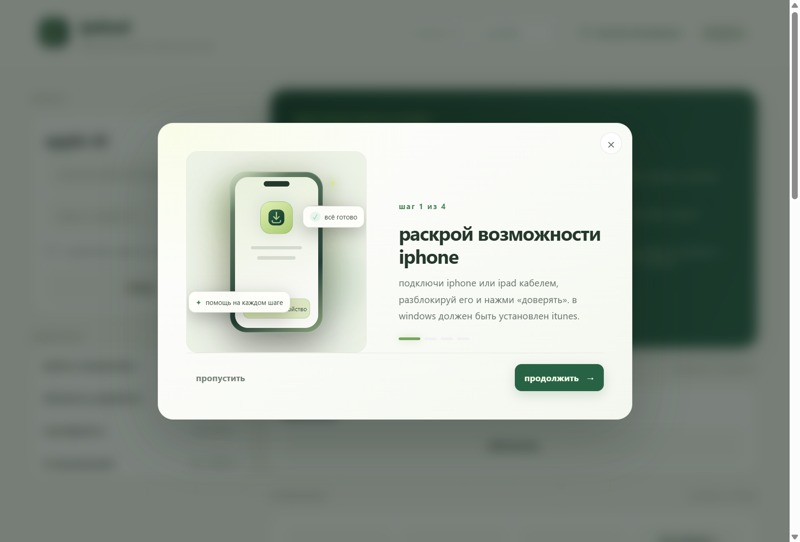
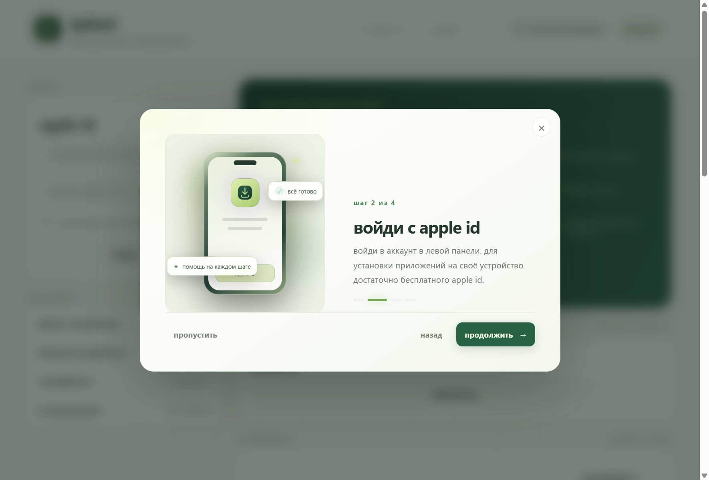

<p align="center">
  
</p>

<h1 align="center">ipaload</h1>

<p align="center">Установка приложений на iPhone и iPad — просто и понятно.</p>

---

## Скриншоты



На главном скриншоте показан первый запуск без подключённого устройства.

### Анимированная инструкция

| Шаг 1 — подключение устройства | Шаг 2 — вход с Apple ID |
| --- | --- |
|  |  |

| Шаг 3 — выбор устройства | Шаг 4 — установка приложения |
| --- | --- |
|  |  |

### Часто задаваемые вопросы


## Возможности

- Обновлённый интерфейс ipaload в светлой зелёно-лаймовой цветовой гамме.
- Установка SideStore (стабильная и предварительная сборки) и LiveContainer + SideStore.
- Установка собственных IPA-файлов.
- Подключение iPhone и iPad, импорт и управление файлами сопряжения.
- Вход через Apple ID, управление сертификатами разработчика и App ID.
- Встроенная анимированная инструкция, которую можно открыть повторно из верхней панели.
- Часто задаваемые вопросы прямо на главном экране.
- Русский язык включён по умолчанию; английский доступен в переключателе языка.

## Быстрый старт

1. Подключите iPhone или iPad кабелем, разблокируйте его и подтвердите запрос «Доверять этому компьютеру».
2. На Windows установите [iTunes](https://apple.co/ms), необходимый для связи с устройством.
3. Откройте ipaload и войдите в Apple ID. Для подписи приложений подойдёт бесплатный аккаунт.
4. Выберите подключённое устройство в разделе «Устройства».
5. Выберите SideStore или LiveContainer либо нажмите «Импорт IPA», чтобы установить собственный файл.

При первом запуске ipaload показывает пошаговую анимированную инструкцию. Её можно пройти кнопкой «Продолжить», вернуться на предыдущий шаг, закрыть или в любой момент открыть снова кнопкой «Краткая инструкция».

Настройки ipaload хранятся отдельно от оригинального iLoader. При первом запуске войдите в Apple ID повторно.

## Элементы интерфейса

- **Аккаунт** — вход и выход из Apple ID, выбор сохранённого аккаунта.
- **Устройства** — выбор подключённого устройства и обновление списка.
- **Установщики** — установка SideStore, LiveContainer + SideStore или собственного IPA.
- **Управление** — файлы сопряжения, сертификаты и идентификаторы приложений.
- **Настройки** — язык и другие параметры приложения.
- **TikTok и Telegram** — кнопки внизу окна ведут на страницы автора.

## Сборка из исходного кода

Требуются Node.js, Rust и, для Windows, iTunes. В корне проекта выполните:

```powershell
npm install
npm run tauri dev
```

Собрать Windows-приложение:

```powershell
npm run tauri build -- --no-bundle
```

Готовый исполняемый файл появится в `src-tauri/target/release/ipaload.exe`. Для production-установщика NSIS используйте `npm run tauri build -- --bundles nsis`.

## Решение проблем

- Если устройство не отображается, проверьте кабель, разблокируйте iPhone, подтвердите доверие компьютеру и нажмите «Обновить устройства».
- В Windows убедитесь, что установлен iTunes.
- Для диагностики откройте «посмотреть логи» в настройках и при необходимости выберите уровень логирования Debug.
- Ошибки подписи могут быть связаны с лимитом бесплатного Apple ID на сертификаты или App ID.

## Социальные сети

- TikTok: [@xedazu](https://www.tiktok.com/@xedazu)
- Telegram: [канал ipaload](https://t.me/+WkJo-baL_tkwMWY5)

---

ipaload — неофициальный форк [iLoader](https://github.com/nab138/iloader). Сведения об исходном проекте, авторах библиотек, переводчиках и лицензии приведены ниже.

## Язык и переводы

В интерфейсе доступны русский язык (по умолчанию) и английский. Переводы находятся в `src/locales/ru.json` и `src/locales/en.json`; все тексты русского интерфейса следует писать строчными буквами.

Чтобы предложить правку перевода, измените соответствующий JSON-файл. Список доступных языков, загружаемые словари и резервный язык настроены в `src/i18next.ts`.

Благодарим всех авторов переводов исходного проекта, перечисленных ниже.

## Авторы исходных библиотек

- Original iLoader icon made by [Transistor](https://github.com/transistor-exe); ipaload's download mark is a custom SVG.
- UI improved by [StephenDev0](https://github.com/StephenDev0)
- [idevice](https://github.com/jkcoxson/idevice) by [jkcoxson](https://github.com/jkcoxson) for communicating with iOS devices
- [isideload](https://github.com/nab138/isideload) for installing apps
  - [idevice](https://github.com/jkcoxson/idevice) by [jkcoxson](https://github.com/jkcoxson) crate is used to communicate with the device
  - [apple-codesign-quick](https://github.com/Dadoum/apple-codesign-quick) by [Dadoum](https://github.com/Dadoum) for codesigning and entitlements
  - [Impactor](https://github.com/claration/Impactor) by [claration](https://github.com/claration) was used as a reference for cryptography operations (converting certs to p12, etc.).
  - [Sideloader](https://github.com/Dadoum/Sideloader) by [Dadoum](https://github.com/Dadoum) was used as a reference for how apple private developer endpoints work
- [idevice_pair](https://github.com/jkcoxson/idevice_pair) was used as a reference for pairing file management
- App made with [tauri](https://tauri.app)

## Авторы переводов

Спасибо всем, кто помогает с переводами! Как предложить новый перевод — описано в разделе «Добавление переводов».

- [By3lish](https://github.com/by3lish): Azerbaijani (az)
- [TNT-333](https://github.com/TNT-333): German (de)
- [basketshoe](https://github.com/basketshoe): Italian (it)
- [baocreata](https://github.com/baocreata): Vietnamese (vt)
- [IamArayel](https://github.com/IamArayel): French (fr)
- [kkula9999](https://github.com/kkula9999): Traditional & Simplified Chinese (zh_tw & zh_cn)
- [sibwaze](https://github.com/sibwaze): Russian (ru)
- [notmalicik](https://github.com/notmalicik): Română (ro)
- [mirdukkkkk](https://github.com/mirdukkkkk): Improved Russian (ru)
- [okinaau](https://github.com/okinaau): Arabic (ar)
- [ChouChiu](https://github.com/ChouChiu): Cantonese (zh_hk) & Improved Chinese (zh_tw & zh_cn)
- [marcinmajsc](https://github.com/marcinmajsc): Polish (pl)
- [ern775](https://github.com/ern775): Turkish (tr)
- [canpng](https://github.com/canpng): Improved Turkish (tr)
- [jazoppix](https://github.com/jazoppix): Spanish (es)
- [eseiker](https://github.com/eseiker): Korean (ko)
- [seomin0610](https://github.com/seomin0610): Improved Korean (ko)
- [Ordyan777](https://github.com/Ordyan777): Armenian (am)
- [kakik0u](https://github.com/kakik0u): Japanese (ja)
- [lkspodmol](https://github.com/lkspodmol): Czech (cs_cz)
- [marcusherelammonstyle-cmd](https://github.com/marcusherelammonstyle-cmd): Swedish (sv)
- [MCI49312](https://github.com/MCI49312): Hungarian (hu)
- [Kynonim](https://github.com/Kynonim): Indonesian (id)
- [DD00031](https://github.com/DD00031): Dutch (nl)
- [Toritan123](https://github.com/Toritan123): Improved Japanese (ja)
- [marcinmajsc](https://github.com/marcinmajsc): Improved Polish (pl)
- [dleiferives](https://github.com/dleiferives): Greek (el)
- [ShadowWLX](https://github.com/ShadowWLX): Improved French (fr)
- [fkpcomposer](https://github.com/fkpcomposer): Brazilian Portuguese (pt_br)
- [474FrediFred](https://github.com/474FrediFred): Swiss German (de_ch)
- [bovae](https://github.com/bovae) & [b1twalker](https://github.com/b1twalker): Ukranian (uk)

## License

Copyright (C) 2026 nab138

The source code of this repository is licensed under the MIT License. See the [LICENSE](./LICENSE) file for the full text.

Branding, logos, media assets, and the name “iloader” are not licensed under the MIT License and are subject to separate restrictions.

You may retain or use branding materials in forks, tutorials, or documentation if you include a clear link to either the official site (https://iloader.app) or the iloader source code repository (https://github.com/nab138/iloader) and do not imply official endorsement. See [LICENSE-BRANDING](./LICENSE-BRANDING) for full details.

## Contributing

Please read our [Contributing](./CONTRIBUTING.md) policy before making a contribution.

## Future Plans

Разработка ipaload продолжается. Предложения и исправления можно будет отправить в репозиторий проекта после его публикации.
